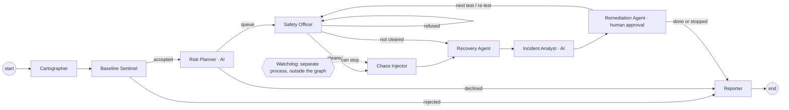

# Agents (LangGraph mission)

`chaosctl mission` (or **Start mission** on the dashboard's *Agent mission* page) runs nine agents coordinated by a
LangGraph state graph (`src/chaosctl/agents.py`). Agents share one mission state; conditional edges decide who works next.

| Agent | Components it owns | LLM | Responsibility |
|---|---|---|---|
| Cartographer | Docker Compose config, Jaeger traces | no | services, dependencies, data flows, weak spots |
| Baseline Sentinel | journey probes, Locust load, container health | no | quality gate: no testing of an unhealthy system |
| Risk Planner | Claude API, FMEA, failure catalog | **yes** | rates every failure mode (S×O×D); queue = AI picks + highest-risk failure of every remaining type, then the tripwire safety test |
| Safety Officer | allow-list, identity check, kill switch, watchdog, steady-state gate | no | clears or refuses each test |
| Chaos Injector | Docker CLI, tc netem helper, CPU limits, Locust | no | injects and holds the failure |
| Recovery Agent | verified rollback, recovery watch, data-durability check | no | undoes the failure and proves it |
| Incident Analyst | Jaeger, container logs, compose facts, Claude API | **yes** | where / how / why with evidence-checked citations and pattern fixes |
| Remediation Agent | vetted fix catalog (`fixes/catalog.toml`), compose override, re-test | no | presents fixes, **asks the human** (Approve / Decline on the dashboard or `chaosctl decide`), applies a vetted fix, re-runs the same test and keeps the fix only if the re-test proves it; otherwise reverts. No answer within 15 min = no change |
| Reporter | FMEA, mission report, website | no | `artifacts/missions/<id>/report.md` |

Safety: a fault is always rolled back by the Recovery Agent; if the graph fails, the mission's safety net closes any
open run and reconciles the fault registry; the watchdog and kill switch work without any agent.
Evidence: `tests/test_mission.py` (simulated end to end: all agents, all 5 failure types in priority order, verified
rollback, tripwire auto-stop, human Approve → fix proven / Decline → rollback only).
